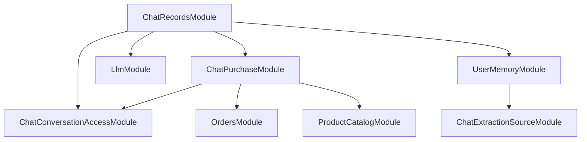

# 聊天购买技术文档

## 状态与目标

- 状态：2026-11-08 用户已确认。
- 实现状态：已按本文完成接口、增量迁移及页面代码集成；实际验证和剩余验收项见实施文档，尚未部署。
- 前置审批：2026-11-08 用户回复“确认”，已确认 PRD、设计及聊天购买 CRUD 契约。
- 最后更新：2026-11-08。
- 关联文档：[PRD](./chat-purchase-prd.md)、[设计](./chat-purchase-design.md)、[实施](./chat-purchase-implementation.md)、[购买契约](../contracts/chat-purchase-crud-contract.md)、[订单契约](../contracts/order-crud-contract.md)、[聊天记录契约](../contracts/chat-records-crud-contract.md)、[流式契约](../contracts/chat-streaming-crud-contract.md)。

实现商品卡购买入口、服务端购买草稿、聊天补齐信息、显式确认下单、模拟支付和本人订单页面。保持单商品单 SKU、每会话一份活跃草稿、24 小时有效期、30 分钟订单支付期及无模型订单写工具的已确认边界。

技术方案及[实施文档](./chat-purchase-implementation.md)均已获用户确认。2026-11-08 按既定分工完成实现；若后续要求改变已确认的数据范围、权限或 API 行为，仍先返回设计与契约阶段审批。

## 现状与依赖

| 已核实能力                                       | 复用及必要调整                                                                         |
| ------------------------------------------------ | -------------------------------------------------------------------------------------- |
| Nest 12.2、Zod 4、`StandardSchemaValidationPipe` | 沿用严格请求 schema、JWT、当前用户及标准异常；Swagger DTO 只提供文档元数据             |
| MikroORM 7.2.5、PostgreSQL 17                    | 复用显式事务、行锁、事务级 advisory lock 和增量迁移                                    |
| 订单 `createForUser()`                           | 当前自行 fork 并开启事务；必须提取共享创建核心，不能嵌套调用后宣称与草稿原子提交       |
| 订单库存协作端口                                 | 复用 SKU 加锁、库存检查和 `active_order_sku_reservations` 派生预占，不新增可变预占计数 |
| 商品有效 SKU 分页                                | 默认第一页不足以判定唯一规格；补充模块公开的完整、有界购买规格投影                     |
| LangChain core、LangGraph、现有 `ToolNode`       | 沿用每轮注入 `extraTools` 的工厂模式，不更换 agent 框架                                |
| Vue 3.5、Pinia、Axios、shadcn-vue、Reka、Lucide  | 复用现有 store、请求底座和 UI；不新增运行时依赖                                        |
| API 的 Node/tsx 测试                             | 补充后端业务、HTTP 和 PostgreSQL 集成测试；不安装前端测试框架、不新增前端测试脚本      |

开发时继续保留原生 ESM 的 `.js` 相对导入后缀。无新增环境变量、第三方服务、支付密钥或后台定时任务。

已阅读的官方依据：

- [MikroORM 7.2.5 事务与并发](https://github.com/mikro-orm/mikro-orm/blob/v7.2.5/docs/docs/transactions.md)：调用方事务 EntityManager、悲观锁必须处于事务中。
- [PostgreSQL 17 显式锁](https://www.postgresql.org/docs/17/explicit-locking.html)、[部分索引](https://www.postgresql.org/docs/17/indexes-partial.html)、[日期时间函数](https://www.postgresql.org/docs/17/functions-datetime.html)：锁顺序、活跃草稿唯一性、事务开始时间与实际时钟的区别。
- [Zod API](https://zod.dev/api)：`strictObject`、可选/可空字段与 refinement；Nest schema 参数绑定另已核对本地安装的官方包声明及 Pipe 实现。
- [LangChain JavaScript tools](https://docs.langchain.com/oss/javascript/langchain/tools)、[LangGraph 工作流](https://docs.langchain.com/oss/javascript/langgraph/workflows-agents)：结构化工具与现有工具循环。
- [Pinia 核心概念](https://pinia.vuejs.org/core-concepts/)、[状态](https://pinia.vuejs.org/core-concepts/state.html)：setup store、响应式引用及重置边界。
- shadcn-vue [Button](https://shadcn-vue.com/docs/components/button)、[AlertDialog](https://shadcn-vue.com/docs/components/alert-dialog)、[Dialog](https://shadcn-vue.com/docs/components/dialog)、[Select](https://shadcn-vue.com/docs/components/select)、[Pagination](https://shadcn-vue.com/docs/components/pagination)：已通过本地 CLI 文档命令与官方页面核对，不复制基础 UI 实现。

## 所有权、目录与依赖方向

新增 `chat-purchase` 所有草稿及确认编排；正式订单仍归 `orders`，商品事实仍归 `product-catalog`。跨模块只消费所有者公开的类型、token 和端口，不引用私有 Entity、Repository 或 DTO。

```text
apps/api/src/
  chat-purchase/
    chat-purchase.module.ts
    index.ts
    controller/chat-purchase.controller.ts
    dto/                         # 请求 schema、Swagger 与响应文档
    entity/chat-purchase-draft.entity.ts
    service/                     # 草稿生命周期、确认编排、公开投影
    tool/                        # 每轮绑定身份的草稿工具工厂
    spec/
  chat-records/
    conversation-access/         # 叶子模块：归属检查与事务内会话锁
    context/                     # 当前购买运行上下文、token 预算
    display/                     # purchase 引用绑定与恢复
    extraction-source/           # 长期记忆来源资格过滤
    history/                     # 过滤已脱敏的购买工具历史
    trace/                       # 购买工具专属持久化白名单
  orders/
    port/                        # 调用方事务中的确认下单公开能力
    service/                     # 现有 API 与新入口共享创建核心
  product-catalog/
    port/                        # 有界购买规格读取与现有订单协作端口
  user-memory/                   # 来源过滤、混合批次和缓存候选保护

apps/web/src/
  api/modules/chat-purchase.ts
  api/modules/orders.ts
  api/types/chat-purchase.ts
  api/types/orders.ts
  components/shared/orders/      # 聊天、本人订单页共用的订单展示与动作
  pages/chat/components/         # 购买草稿与确认卡，页面私有
  pages/account/orders/
    index.vue
    page.ts
    components/
```

这些路径表达职责边界，具体服务拆分在实施文档列出；不为单文件机械增加空目录。

依赖图：



`ChatConversationAccessModule` 归 chat-records 所有，只注册会话访问所需能力，参照现有 extraction-source 叶子模块；不导入完整 ChatRecordsModule。`llm` 不依赖购买、订单或聊天 Entity。购买工具工厂由聊天编排取得并传入通用 LLM 服务。

## 公开内部接口

| 所有者          | 能力                                                                                     | 约束                                                                                       |
| --------------- | ---------------------------------------------------------------------------------------- | ------------------------------------------------------------------------------------------ |
| chat-records    | `ChatConversationAccess`：本人检查、`lockOwnedInTransaction(em, userId, conversationId)` | 返回最小会话标识；锁定后重新判定归属，不向购买模块暴露 Entity                              |
| product-catalog | 购买规格投影：商品身份、有效 SKU、真实颜色尺码、价格、有货标志                           | 使用调用方 EntityManager，以单次数据库快照查询完整有界集合；不暴露精确库存；检查集合完整性 |
| orders          | `createConfirmedInTransaction(em, userId, input, expectedSnapshot)`                      | 要求已开启事务；禁止 fork、另开事务或自行重试已失败的事务                                  |
| orders          | 本人订单详情与现有动作                                                                   | 用安全响应类型，不暴露 Entity；重用原鉴权与状态规则                                        |
| chat-purchase   | 读取、发起、更新、放弃、确认、运行上下文及工具工厂                                       | 身份来自服务端；HTTP 与工具使用同一业务核心及校验                                          |

订单端口接收的是服务端构造的单 SKU 输入及确认条件，不接收客户端价格。expectedSnapshot 包含商品身份、SKU、名称、颜色、尺码、币种、单价、展示图片及锁定草稿的 expiresAt；数量、收货字段来自锁定草稿。金额沿用订单整数分与 `bigint` 计算，运费为 `0.00`。

`orders` 提取事务内创建核心后，旧 `POST /orders` 仍自行开启事务、使用原请求 schema 和幂等键；新入口使用调用方事务，并在锁定 SKU 后、任何订单或明细写入前比较确认条件及草稿截止时间。对新入口返回安全判别结果：created、replayed、quote_changed、unavailable、insufficient_stock、draft_expired；标准异常仍用于基础设施和非法调用。不为业务失败新建通用异常框架。

## 持久化模型与迁移

新增 `chat_purchase_drafts`，由购买模块维护：

| 列组                                     | 存储及约束                                                                     |
| ---------------------------------------- | ------------------------------------------------------------------------------ |
| `id`、`user_id`、`conversation_id`       | UUID；归属字段不可修改；会话外键 `ON DELETE CASCADE`，用户关系沿用现有删除策略 |
| `product_external_id`、`sku_id`          | externalId 必填；SKU 可空，作为业务标识保存，不级联删除草稿                    |
| `quantity`                               | integer，CHECK 1–99                                                            |
| `recipient_name/phone/address`           | 分列可空，边界同订单；未完成不以空字符串代替 null                              |
| `status`、`version`                      | 状态 CHECK；version 正整数，服务端条件更新                                     |
| `confirmation`、`issues`                 | JSONB 白名单结构；确认包含自身版本，问题不包含内部库存或供应商对象             |
| `submission_key`                         | 服务端生成 UUID，唯一且草稿生命周期内稳定，不由浏览器或模型生成                |
| `submitted_version`、`order_id`          | 成功确认输入版本及唯一订单关联；提交后不可改写                                 |
| `created_at`、`updated_at`、`expires_at` | timestamptz；updatedAt 专指最后有效用户修改，不使用通用 ORM onUpdate           |

约束与索引：

- `UNIQUE (conversation_id) WHERE status IN ('collecting', 'ready')` 保证每会话一份活跃草稿。谓词不依赖当前时间；过期必须在会话锁内先转换状态再新建。
- `order_id` 非空唯一；submitted 必须有 orderId、submittedVersion，其他状态不得有订单关联。
- 草稿指向订单的外键使用 RESTRICT，不允许删除草稿时删除订单；会话删除仅级联草稿。订单和订单幂等记录不反向级联依赖草稿。
- `(conversation_id, created_at, id)` 支持当前/最近一次购买读取；若有活跃草稿优先返回，否则按 createdAt、id 确定最近一份。
- 不复制订单表、不新增预占表、不保存跨购买默认地址。

另给 `chat_messages` 增加内部 `memory_extraction_eligible boolean NOT NULL DEFAULT true`。旧消息保持原行为，购买轮次的 user/assistant 消息均写 false；该标志不进入公共聊天响应。购买草稿及此标志使用增量 Migration，审查实际 FK、CHECK、部分唯一索引和历史数据兼容性；注册 Entity 并同步迁移快照。

回滚会删除新增草稿及资格标记，丢失未提交购买状态并失去来源隔离能力；不得在仍运行新代码或仍有购买记忆任务时直接回滚。正式订单和原幂等记录始终保留。迁移验证只使用命名的可销毁数据库，不操作默认开发库，不以 `migration:fresh` 验证普通功能。

## 状态、报价与有效期

所有购买请求先校验本人会话，再锁定会话与目标草稿。仅首次 start 或用户引起的规范化值变化更新 updatedAt，并将 expiresAt 置为该次数据库实际时间加 24 小时。trim 后相同值、同商品恢复、重复请求、轮询和重新报价不续期；预期版本仍须匹配。

状态归约规则：

1. 到期且尚未提交：转换 expired、推进版本、清空可提交确认；终止态不再恢复。
2. 缺失 SKU、收件字段，或选择不可用/数量不足：collecting，confirmation 为 null，保留用户已填字段。
3. 所有字段有效且当前可售：ready，由服务端生成确认快照。
4. 有效用户修改：版本推进一次；完成字段更新和报价后以同一个新版本返回，不暴露中间版本。
5. 商品名称、图片、规格、币种或单价等确认内容变化：推进版本并生成新确认，加入重新确认原因；不能在同次确认请求中接受新条件。
6. 库存变化只在可提交资格或公开问题发生变化时推进版本；不把精确库存量作为每次版本变化的依据。重复读取相同状态不持续增长版本。
7. 价格变化提示是针对该版本的重新确认信息，本身不禁止用户阅读新快照后点击；缺货、下架和字段缺失才阻止生成可提交确认。
8. 确认成功：submitted，记录成功输入版本，推进草稿版本，关联唯一订单，停止草稿期限规则。

公开 `issues` 使用判别联合：`missing_field` 携带允许的字段名，`sku_selection_required`、`product_unavailable`、`sku_unavailable`、`insufficient_stock`、`price_changed`、`specification_changed`、`expired` 不含任意工具输出。文案由受控映射生成，不返回原始 SQL、库存数量或收货值。

读取当前状态可以在短事务中持久化到期/报价变化，不修改用户修改时间。商品查询暂时失败则回滚本次刷新并返回失败，不将其写成下架。规格读取必须检查集合完整；已有公开分页供前端选择使用，服务端唯一规格判定不依赖第一页或客户端遍历结果。

## 事务、锁顺序与确认

锁不得跨模型调用、HTTP 网络调用或前端等待。所有事务使用隔离的 EntityManager，悲观锁仅在活动事务内取得。

新购买写路径的顺序：

```text
本人会话行
  → 草稿行
  → 当前用户 + submission_key 的订单幂等 advisory lock
  → 本次完整 SKU 集合按 UUID 升序
  → 必要的既有订单行按 UUID 升序
```

订单旧路径维持幂等锁 → SKU → 订单；商品导入维持导入锁 → 完整 SKU 集合 → 订单。订单或商品路径不得回头获取会话/草稿锁。锁后若发现所需 SKU 集合改变，整笔回滚后重试，禁止持有订单锁再追加 SKU 锁。

确认流程：

1. 锁本人会话和指定草稿，检查路径归属。若 submitted 且 expectedVersion 等于 submittedVersion，先返回关联订单当前详情；此分支早于期限、商品和当前草稿版本判断。
2. 其他版本的 submitted、终止态或版本不符返回 409。首次提交必须为 ready，使用草稿已存确认，禁止从请求重建价格。
3. 订单端口获取幂等锁、SKU 锁，验证当前商品与 SKU、确认内容、数量和派生可售库存。
4. 订单端口内部在竞争锁全部取得后、执行创建核心的任何写入前，用数据库 `clock_timestamp()` 再判断传入的草稿截止，达到截止时间返回 draft_expired。新确认路径以此时刻创建订单并计算 30 分钟支付期；不能以事务开始时的 `now()` 跨长时间等待继续放行，原订单 API 的时间行为不在本次顺带改写。
5. 在同一个事务内创建订单、明细、原订单幂等记录，并更新草稿的 submittedVersion、orderId、status、version；全部成功才提交。
6. 首次返回 201；同成功版本重试返回 200。响应发送失败、客户端取消请求或之后聊天失败不回滚已提交结果。

业务冲突需要落库失效状态时，事务回调返回失败判别结果，在事务提交后再由应用层抛 409。例如变价提交只提交新版本确认，不创建订单；若直接在事务内部抛异常，新确认会回滚，必须避免此错误。数据库错误和未知异常整笔回滚，不留下部分订单或预占。

幂等身份是草稿稳定 submissionKey；旧请求哈希仍由订单模块维护。失败确认没有订单幂等记录，用户修改后可用同草稿重新确认；成功后输入不能再变。唯一约束冲突的恢复必须在失败事务之外重新读取，不能在已中止的 PostgreSQL 事务里继续操作。

GET 和确认重试返回订单时调用本人订单公开投影，沿用既有超时关闭逻辑及其 SKU→订单锁顺序。已支付、关闭或完成的订单仍是同一次购买结果，不因草稿期限或商品删除另建订单。

### 会话删除竞争

现有删除会话会先调用偏好来源生命周期，其前缀是偏好用户 advisory lock。保留该顺序，再锁本人会话、清理来源并删除；不得先拿会话锁再等待偏好用户锁。购买事务不取得偏好用户锁，避免环路。

公开删除与“新会话生成取消后的内部删除”均走同一会话锁协调：删除先成功则后续购买返回 404；确认先成功则删除草稿但保留订单及幂等。内部取消清理仅删除仍为空、且无购买草稿的临时会话；一旦用户已在该会话开始购买，就保留会话供恢复，不能因生成取消悄悄删除有效草稿。

新会话在未形成可恢复服务端会话前不开放购买动作；前端不得把本地 session key 当 conversationId。聊天消息保存也在同一会话访问规则下确认会话仍存在，不能用旧内存 Entity 将已删除会话重新插入。

## 请求 Schema 与 HTTP

请求 schema 放在 `chat-purchase/dto/chat-purchase.schema.ts`；响应类型与 Swagger 文档放同模块 DTO 目录，通过公开入口导出所需类型。

| Schema                             | 绑定位置                                      | 规则                                                                                                |
| ---------------------------------- | --------------------------------------------- | --------------------------------------------------------------------------------------------------- |
| `purchaseConversationParamsSchema` | GET/start 的 `@Param({ schema })`             | strict conversationId UUID                                                                          |
| `purchaseDraftParamsSchema`        | PATCH/discard/confirm 的 `@Param({ schema })` | strict conversationId、draftId UUID                                                                 |
| `startPurchaseSchema`              | start 的 `@Body({ schema })`                  | externalId trim 1–160、无控制字符；expectedVersion 为正整数或 null，两者必填                        |
| `patchPurchaseSchema`              | PATCH 的 `@Body({ schema })`                  | expectedVersion 必填；skuId 可选/可空；quantity 可选但非空，真实整数 1–99；recipient 严格按字段合并 |
| `purchaseVersionSchema`            | discard/confirm 的 `@Body({ schema })`        | 仅 expectedVersion 正整数                                                                           |
| `purchaseEmptyQuerySchema`         | 全部购买路由的 `@Query({ schema })`           | strict 空对象，拒绝未声明查询参数                                                                   |

所有版本、数量使用 `z.number().int()`，不接受数字字符串；无客户端默认值。数量默认 1、nullable 收货字段、时限及身份均由服务端创建草稿时设置。输入类型使用 `z.input`，解析后类型使用 `z.output`；仅 trim 不产生不同结构时可用 `z.infer`，不手工复制验证类型。

recipient 的 name trim 1–100、address trim 1–500 且拒绝控制字符；phone trim 后为可选前导 `+` 和 6–20 位数字。省略保持原值，null 清空，空字符串非法。PATCH 至少存在一个实际可编辑键；`{ expectedVersion, recipient: {} }` 不成立，嵌套 `undefined` 也不能伪装字段。字段存在但规范化值未变是合法同值操作，不续期。

非法 schema 经 Nest Pipe 返回 400；JWT/禁用账号沿用 401；本人会话、草稿或订单不存在/越权统一 404；版本、期限、缺失、报价和库存业务冲突为 409；基础设施错误沿用既有 503/500 映射。Controller 仅绑定输入、身份并调用服务，不重复 parse，不读数据库。

订单列表 Query、详情 Param 和 `{}` 动作 Body 复用原 schema。旧 `POST /orders` 不增加 expectedVersion/客户端价格字段。新增接口同步 Swagger 安全响应、201/200 差异和错误说明。

## 聊天工具、运行上下文与历史

每轮聊天构造绑定 `userId`、服务端 conversationId 和运行标识的工具，模型不能提供或覆盖身份：

- `get_purchase_draft`：读取当前草稿、完整可选规格、安全状态及缺失字段。
- `update_purchase_draft`：以 draftId、expectedVersion 和经过同一 schema 的明确字段更新。
- `discard_purchase_draft`：只放弃未提交草稿，仍要求版本。

没有 start、confirm、payment、cancel-order、receipt 工具。start 由卡片按钮直接调用；模型不得从纯文本商品名称创建新购买。工具发现歧义时不修改，继续询问。多个并行工具修改同一版本仅一个成功，其他返回安全 version_conflict 结果，禁止静默重放覆盖。

当前草稿作为独立运行上下文加入 `ChatContextService.prepare()`，计入 token 预算，优先保留必要的身份引用、真实规格、数量、字段已填标志、状态和问题。不注入完整收货快照，不放入 memoryContext、持久化摘要或全局 system config；每轮从权威草稿读取，模型按已填标志避免重复询问。完整地址仅由本人购买 API 与确认卡展示。

同步更新 `system-context.md`、`shopping-flow.md` 中原先订单不可用的提示，明确可以准备草稿、只有用户按钮执行正式动作，售后仍未接入。不得将收货细节复述进后续普通回答或摘要；当前购买事实不能从旧摘要恢复或覆盖。摘要来源跳过标记为不可提取的购买消息，推进摘要水位时仍覆盖这些已跳过消息，避免反复压缩；近程聊天原文的既有读取权限不变。

### Trace 与公开展示

购买工具结果仅返回引用、版本、状态、字段已填标志、真实规格和公开 issues，不包含 recipient 值。持久化 trace 还须覆盖模型输出中的嵌套 `tool_calls`、非法调用，以及独立 `tool_call`、`tool_result`；只处理 activity 或独立参数不足以防止副本。

在 chat-records trace 边界对上述事件做按工具名识别的白名单副本：只存 draftId/version、变更字段名、状态及安全问题，不存收货参数或完整原始异常。不修改传给活图执行的参数。普通请求日志、Controller 日志和错误日志同样不记录购买请求 Body。

历史重建不能把已脱敏的购买调用当成可执行事实：一致过滤购买工具调用与对应结果，保留同一批中的普通商品工具配对，避免孤立 ToolMessage。以当前草稿上下文替代购买工具回放。用户原始文本与助手普通文本仍按既有记录规则保存，不承诺自然语言正则擦除。

### JSON、SSE 与历史引用

在现有 `PublicDisplayEnvelope` v1 内添加可空 purchase 引用 `{ draftId, version, orderId }`；旧 envelope 读取默认 null。构建、恢复、历史映射、JSON 响应、前端解析均同步扩展。引用不是可信订单成功证明，按钮所需数据从业务 API 读取。

原公开展示上限 16 KiB、内部 trace 上限 32 KiB 保持。除最终编码校验外，必须扩展 `reservedDisplayBytes()`，提前预留最大购买引用容量，避免流末绑定超限。

流式路径沿用 trace final sequence；JSON 路径当前缺少同等绑定，须补充内部运行结果的 finalTraceSequence 元数据并共用保存绑定入口，不向普通客户端公开内部序号。缺少最终 trace 时不得伪造绑定成功。

消息保存事务内重新核实引用属于本人本会话，并与 assistant 展示绑定同事务提交；若草稿已被替换，旧引用仍只关联原草稿，不得指向新草稿或冒充最新版本。成功保存后发送 SSE `purchase`，再发 `done`；`done` 保持最后业务事件。消息失败或取消不发送正式 purchase，但已提交草稿修改可独立恢复。

## 收货信息与长期记忆隔离

当前 `persistChat()` 无条件排队 Markdown 记忆任务，来源读取器直接提供原始 user/assistant 文本，单靠提示词或敏感词不足以保护收货信息。本方案在来源层隔离购买轮次：

1. 轮次开始存在活跃购买、使用购买上下文/工具，或轮次期间购买状态发生变化，均将该轮次两条消息的 `memoryExtractionEligible` 设 false；保存前在会话锁内再次检查本轮开始后的草稿创建/版本变化，覆盖“生成中点击购买”的竞争。
2. 这些轮次不排队长期记忆提取。标志随消息同事务保存，不由浏览器提交，不因丢失 SSE done 而改变。
3. extraction-source 的单轮读取再次检查资格；批量读取过滤被排除的轮次，保留同批合法轮次。全部排除时返回空集合并安全完成，不调用模型；账号失效、归属失败或消息缺失仍按原来源无效语义处理。
4. 批量过滤结果保留实际来源消息 ID。任务在持有现有租约条件下归一化 sourceTurns；来源集合改变时清空 cached candidateOperations，再仅用合法来源生成，不能把含排除轮次的旧候选直接应用。来源不变的重试继续复用候选，旧单轮任务全被排除时安全完成。
5. 保存候选及应用前再次验证来源、租约、记忆开关和 generation；不能先读合法来源，随后复用另一个来源集合的缓存。沿用现有文档并发和清空保护，不另建记忆任务系统。

标志在消息写入后不可从 false 改 true；过滤也不能从旧聊天摘要、trace 或整个会话重建被排除文本。后续与购买无关、未使用购买上下文的普通聊天恢复现有记忆行为，不永久关闭用户记忆。用户主动维护的结构化偏好和手动编辑 Markdown 不受此次自动来源隔离改变。

这属于已确认“不将收货信息写入长期记忆”的实现约束，不增加记忆公开 API。实施时在现行[记忆契约](../contracts/user-memory-crud-contract.md)补充来源隔离交叉说明；不沿用历史设计中已被后续契约替代的自动偏好行为。

## 前端状态与交互

### 商品卡和聊天购买

`ChatProductResults` 声明类型化 buy emit，经 assistant 消息、消息列表逐层传到聊天 page；不在卡片中请求 API。page 调用统一 Axios 适配器，以真实 conversationId 发起购买，再加载服务端草稿及 SKU。

start 成功后通过现有聊天发送入口提交可见消息“请帮我继续本次购买”，触发助手询问缺失信息；身份与商品仍以服务端草稿为准。不得在模板里直接调用模型，也不在 start 重试或刷新恢复时反复自动发送。聊天生成失败只重试询问，不再次创建草稿；确认卡始终可通过独立购买区域恢复。

已有聊天 Pinia session 维护跨路由流式任务，本轮在相同账号/会话作用域保存最小购买请求状态和服务端快照，避免新增无边界单例。输入草稿、替换确认弹窗和局部展开状态留在 page/composable；不在 localStorage 保存 recipient。

不同商品先用 AlertDialog 明确放弃旧草稿，再携带当前版本 start；同商品恢复。SKU Select 的选项直接对应真实组合，数量使用已有数字输入，确认卡使用服务端金额与收货快照。模型 Markdown 永远不能渲染可执行购买按钮。

异步状态区分 idle/loading/success/empty/error，另区分 submitting 与 unknown。流式生成、草稿更新、确认提交之间禁用冲突操作；前端防重只是体验，服务端版本和幂等仍是最终保证。当前会话的实时购买区域独立于历史分页；历史卡默认不能提交旧版本。

### 未知结果与账号切换

Axios 支持 AbortController，GET 请求使用账号/会话 epoch 和请求序号丢弃旧响应。取消 mutation、超时或断流表示结果未知，保留 draftId 和原 expectedVersion，先 GET 核实；必要时重试相同确认，不生成新键或自动 start。

路由切换后，只能将 mutation 结果归入其原账号/会话缓存；账号变化清理购买与订单缓存并阻止迟到响应回写。加载失败时保留本页尚未提交的输入，展示重试；服务端无法核实商品时禁止确认。组件卸载清理监听、计时器与请求，后台聊天任务沿用现有 session 生命周期。

### 我的订单

新增懒加载 `/account/orders`，通过现有 account 路由 meta/全局 Guard 处理登录。账号导航增加“我的订单”，页面目录遵守 index.vue/page.ts/components。

列表用原 `{ items, total, page, pageSize }`，不假设 totalPages；支持状态筛选、订单号精确搜索与分页。复用现有共享 `AdminPagination` 的通用分页能力，不为名称做额外重构。详情用 Dialog 独立请求完整明细、收货和物流快照，不能从摘要虚构图片或收货字段。

聊天和订单页共用 `components/shared/orders/` 的类型化展示及动作组件，通过 Props/Emits 交互；不导入管理员页面私有组件。公共订单 API 类型可统一状态、金额和明细，管理员 userId 字段仍保持各自响应边界。

模拟支付、取消、确认收货复用原接口，Body 必须为 `{}`；取消和收货使用 AlertDialog，支付按钮明确“模拟支付”。只在对应服务端状态开放动作，倒计时仅作提示，达到本地期限后禁用支付并重新读服务端状态。动作冲突重新读订单，不凭本地按钮修改成成功状态。

Button、Dialog、AlertDialog、Select、Field、Table、Empty、Spinner 和 Lucide 使用现有实现。页面覆盖键盘操作、语义标签、焦点恢复、移动布局和所有异步状态，不新增解释实现细节的产品文案。

## 测试与验证方案

| 层次               | 必须覆盖                                                                                                                               |
| ------------------ | -------------------------------------------------------------------------------------------------------------------------------------- |
| Schema / Nest HTTP | strict 未知字段、UUID、数字字符串拒绝、trim/control、quantity 1/99、版本、PATCH 缺省/null/空 recipient、400 与 Swagger 元数据          |
| 归属与权限         | 普通用户/管理员均仅本人、禁用账号、跨会话 draftId、越权统一 404、模型无正式订单动作工具                                                |
| 草稿生命周期       | 多 SKU 必选、唯一可售 SKU 自动列入、分页完整、同值不续期、有效修改续期、到期边界、替换/放弃、报价失效、读取失败不误判下架              |
| 订单原子性         | 共享事务无 fork、写入中途失败全回滚、变价不下单但提交失效投影、无额外预占、旧多 SKU API 回归                                           |
| PostgreSQL 并发    | 同时 start、并行工具、修改/确认、同确认重复、变价/导入、缺货、等待锁跨期限、删除/确认、失败事务外幂等恢复                              |
| 恢复与幂等         | 丢失响应、原版本重试、submitted 超过 24h、商品变更及订单状态改变后仍返回同一订单、会话删除后订单保留                                   |
| 聊天投影           | JSON/SSE/历史一致、旧 null、v1 兼容、16 KiB 预留、绑定失败、purchase 在 done 前、取消恢复、混合工具历史无孤立结果                      |
| 隐私与记忆         | 嵌套/非法/独立工具 trace 白名单、日志无收货 Body、原聊天文本规则不变、购买轮次不入队、混合批次过滤、缓存失效、开关/generation/删除竞争 |
| 浏览器流程         | 卡片→补齐→确认→模拟支付→我的订单，刷新/分页/切路由/切账号，错误/空态/未知结果，桌面/移动布局与键盘                                     |

后端使用现有 Node/tsx、Nest 测试方式。新增 PostgreSQL 套件按现有模式使用明确的 `RUN_*_POSTGRES_TEST=1` 开关及命名可销毁库；缺少开关或数据库的 skip 必须报告为未执行。测试不连接生产库、不依赖真实模型或第三方密钥；真实模型仅可作另行标明的 Smoke Test。

代码阶段至少执行项目要求：

```bash
pnpm format:check
pnpm --filter @clothes-shopping-guide/api typecheck
pnpm --filter @clothes-shopping-guide/api test
pnpm --filter @clothes-shopping-guide/api build
pnpm check
git diff --check
```

再执行专用隔离库迁移/并发测试、带鉴权 HTTP 主流程及浏览器 Smoke Test。不安装 Vitest、Vue Test Utils 或 Playwright，不增加前端测试脚本；浏览器验证使用届时可用能力，无法完成时明确列缺口，不把构建通过当成流程通过。

本文档阶段仅验证 Markdown 格式、相对链接及差异，不运行迁移或宣称上述验收已经通过。

## 风险与审批

主要风险是调用方共享事务、全局锁顺序、流末展示绑定和自动记忆来源隔离；本文已给出对应约束及测试要求。实施中如发现现有公开端口不能满足原子性，必须先补足所属模块端口，不允许绕过边界直接查询外部私有表。

当前没有新增待选业务范围。本文及[实施文档](./chat-purchase-implementation.md)已于 2026-11-08 获用户确认，业务代码及 Migration 已完成集成。实际结果和未执行的浏览器检查见实施文档，不以技术方案或构建通过替代验收。
